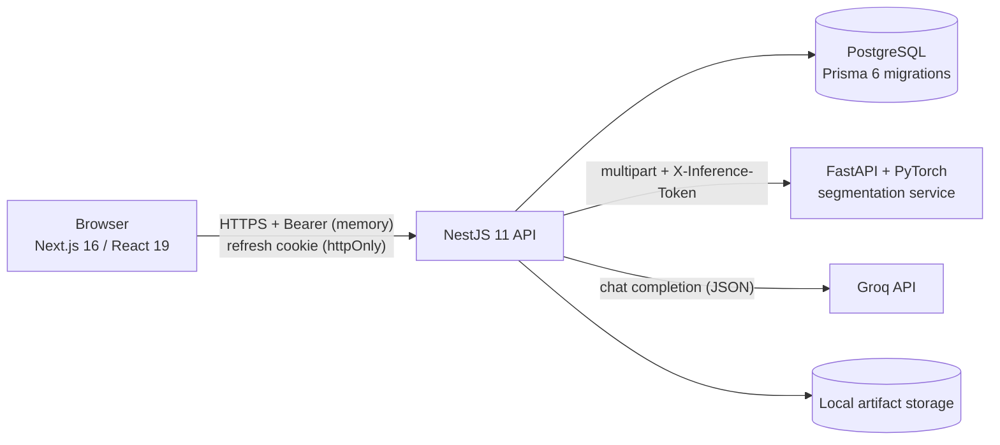

# Clinical Decision Support System (CDSS)

A research prototype that helps licensed clinicians structure their thinking about a case. A
clinician enters a case narrative and basic context (and optionally 2D brain MRI slices); the
system asks a large language model for differential considerations, red flags, missing
information and investigations to consider, validates the answer against a strict schema, and
shows it with its provenance.

> **Status: research prototype.** It is **not** a certified medical device, has **not** been
> clinically validated, and makes **no** claim of HIPAA, GDPR or medical-device regulatory
> compliance. Outputs are suggestions that require independent clinical judgment. Do not use
> it with real patient data without your own security, privacy and regulatory review.

## What it actually does

| Area | Implemented behaviour |
| --- | --- |
| Case analysis | Free-text case + explicit patient context (age group, sex, acuity, history; "not specified" is an explicit choice). One LLM call (Groq, default `openai/gpt-oss-120b`), JSON-only output validated with Zod, one corrective retry on invalid output. Likelihoods are qualitative (high/moderate/low). |
| Failure handling | A failed analysis stores **no result** and is shown as failed. The UI never substitutes placeholder diagnoses or numbers. |
| Provenance | Each analysis records the model reported by the provider, prompt version and SHA-256 of the prompt template, latency and token usage. |
| Safety checks | Server-fixed disclaimer; delimiter escaping of user text; flags (shown to the clinician) for injection-like phrasing, dosing content, imaging references without imaging, and inferred severity. |
| MRI (optional) | PNG/JPEG/WebP 2D slices. A PyTorch encoder–decoder (ResNet-50 encoder, transposed-convolution decoder, **no skip connections — not a U-Net**) segments each image at 128×128. Reported values are pixel counts and ratios (`segmented_pixels`, `foreground_pixels`, `area_percent`, `sqrt_area_percent`), **not physical sizes**. No DICOM support. Unvalidated. |
| Mock mode | `LLM_MOCK=true` (development/tests only; refused in production) returns obviously synthetic output stored with `isMock=true` and labelled in the UI. |
| Accounts | Registration with administrator approval; argon2id passwords (legacy bcrypt hashes upgraded on login); lockout after 5 failures; rotating single-use refresh tokens with reuse detection; suspension that ends sessions immediately; password change; administrator-issued single-use reset links; optional TOTP two-step verification. |
| Authorization | Doctors see and act on their own cases. Organization admins can read (not act on) cases of their own organization and manage its doctors. Super admins see everything. Unauthorized access returns 404. |
| Audit | Security and clinical-access events, scoped by organization. The `audit_logs` table rejects `UPDATE`/`DELETE` through a database trigger. Clinical text is never written to audit metadata. |
| Admin | Live health probes, counts and latencies from stored data, usage analytics and feedback per model/prompt version, read-only configuration view. No GPU utilisation is measured or shown. |
| Data management | JSON export of a case (audited); permanent deletion of a case by a super admin (audited). See [docs/DATA_MANAGEMENT.md](docs/DATA_MANAGEMENT.md). |

Not implemented: self-service password reset by email (no mail transport), DICOM, physical
measurements, FHIR export, background job processing, real-time progress streaming, object
storage for images (files are stored on the backend's local disk).

## Architecture



- `backend/` – NestJS API: auth, case-access policy, analysis pipeline, MRI orchestration, admin, audit.
- `frontend/` – Next.js client UI (all pages are client components).
- `mri-inference-service/` – FastAPI service; model weights are **not** in the repository.
- `infrastructure/terraform/` – AWS configuration (not modified in this round; see
  [docs/IMPLEMENTATION_STATUS.md](docs/IMPLEMENTATION_STATUS.md#deferred-aws-findings)).

## Quick start (Docker Compose, development)

```bash
docker compose up -d --build                          # LLM runs in labelled mock mode by default
docker compose exec -e SEED_ADMIN_PASSWORD='choose-a-long-password' \
  -e SEED_DOCTOR_PASSWORD='choose-another-password' backend node dist/database/seed.js
```

Open http://localhost:3000 and sign in as `admin@cdss.local` / `doctor@cdss.local`; both must
change their password on first sign-in. To use the real model: `GROQ_API_KEY=... LLM_MOCK=false
docker compose up -d backend`. The MRI service needs weights at
`mri-inference-service/models/unet.pth` and otherwise exits at startup with an explicit error.

## Local development without Docker

Requirements: Node.js 24 (22 also works), PostgreSQL 16, Python 3.12 for the MRI service.

```bash
# backend
cd backend && cp ../.env.example .env        # set JWT_ACCESS_SECRET (openssl rand -hex 32)
npm ci && npx prisma generate
npm run prisma:migrate:deploy                 # applies migrations (never resets data)
npm run prisma:seed                           # optional demo accounts (refuses NODE_ENV=production)
npm run start:dev

# frontend
cd frontend && npm ci && npm run dev          # NEXT_PUBLIC_API_URL defaults to http://localhost:4000/api/v1

# MRI service
cd mri-inference-service && pip install -r requirements.txt
ALLOW_CPU_FALLBACK=true MODEL_PATH=models/unet.pth uvicorn app.main:app --port 8000
```

All configuration is validated at startup; see [.env.example](.env.example). Missing or weak
secrets, placeholder API keys and `LLM_MOCK=true` in production stop the server with a list of
problems.

## Database migrations

Schema changes are managed with Prisma migrations in `backend/prisma/migrations`. The container
runs `scripts/migrate.sh` at start (disable with `RUN_MIGRATIONS=false`). Databases created by
earlier versions with `prisma db push` are detected and baselined automatically, then upgraded
without data loss. `scripts/test-migrations.sh` verifies both paths against disposable databases.

## Tests

| Component | Command | What it covers |
| --- | --- | --- |
| Backend unit | `cd backend && npm test` | policy, config validation, passwords, prompts, safety, LLM provider, storage, error filter, eval scoring |
| Backend e2e | `npm run test:e2e` (needs a disposable PostgreSQL database whose name ends in `_test`) | auth/sessions/MFA, tenancy, analysis failures, MRI uploads/artifacts, admin scoping, audit immutability |
| Migrations | `ADMIN_URL=... sh scripts/test-migrations.sh` | fresh + legacy baseline + idempotency |
| Frontend | `cd frontend && npm test` | failed/empty/zero states, form defaults, API client |
| MRI service | `cd mri-inference-service && python -m pytest` | readiness, validation, limits, token, safe loading, non-blocking inference |
| Browser smoke | [tools/browser-smoke](tools/browser-smoke/README.md) | end-to-end workflows in a real browser |
| LLM evaluation | `cd backend && GROQ_API_KEY=... npm run eval:llm` | synthetic cases: schema validity, required concepts, triage level, safety flags (uses API credits) |

CI runs all of these except the browser smoke test and the paid LLM evaluation.

## Documentation

- [docs/IMPLEMENTATION_STATUS.md](docs/IMPLEMENTATION_STATUS.md) – audit findings, what was fixed, verification, remaining work.
- [docs/DATA_MANAGEMENT.md](docs/DATA_MANAGEMENT.md) – retention, export, deletion and audit behaviour.

## License

No license has been chosen for this repository yet. Until the owners add one, no permission to
use, copy or modify the code is granted beyond what GitHub's terms allow.
